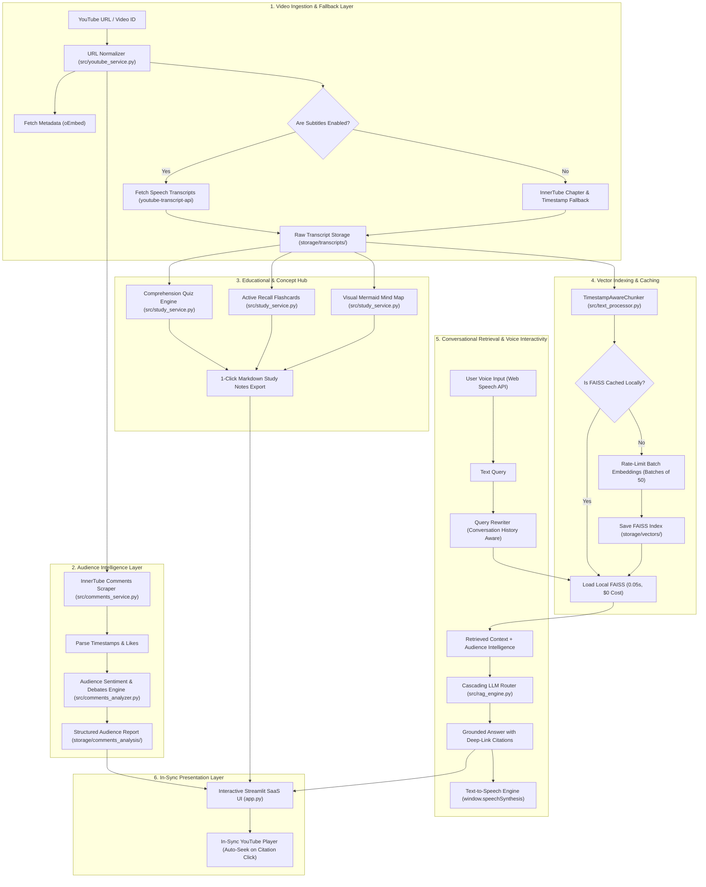

<div align="center">

# 🎬 TubeMind AI
### Production-Grade YouTube RAG, Audience Intelligence & Interactive Study Platform

[](https://www.python.org/)
[](https://streamlit.io/)
[](https://www.langchain.com/)
[](https://github.com/facebookresearch/faiss)
[](https://ai.google.dev/)
[](https://openai.com/)
[](LICENSE)

**Deep semantic search across 2+ hour long-form videos with exact timestamp citations (`[MM:SS]`), in-sync interactive video player seeking, voice-to-voice interaction, concept flashcards, comprehension quizzes, visual Mermaid mind maps, and real-time public audience intelligence without API quota limits.**

[Features](#-key-features--architectural-pillars) • [Architecture](#-system-architecture) • [Module Breakdown](#-sequential-module-by-module-breakdown) • [Getting Started](#-step-by-step-installation--setup) • [Live Usage](#-how-to-run-the-application) • [Troubleshooting](#-troubleshooting--faq)

</div>

---

## 📖 Table of Contents
1. [Overview & The Problem](#-overview--the-problem)
2. [Key Features & Architectural Pillars](#-key-features--architectural-pillars)
3. [System Architecture & Data Flow](#-system-architecture)
4. [Project Directory Layout](#-project-directory-layout)
5. [Sequential Module-by-Module Breakdown](#-sequential-module-by-module-breakdown)
6. [Step-by-Step Installation & Setup](#-step-by-step-installation--setup)
7. [How to Run the Application](#-how-to-run-the-application)
8. [Edge Cases & Resilience Matrix](#-edge-cases--resilience-matrix)
9. [Pre-Tested Benchmark Videos](#-pre-tested-benchmark-videos)
10. [Troubleshooting & FAQ](#-troubleshooting--faq)
11. [Roadmap & Contributing](#-roadmap--contributing)
12. [License & Credits](#-license)

---

## 💡 Overview & The Problem

Most tutorial YouTube chatbots on the internet take a naive approach:
```python
# ❌ The Naive Tutorial Approach (Fails in Production)
transcript = " ".join([chunk["text"] for chunk in transcript_list])
chunks = RecursiveCharacterTextSplitter().create_documents([transcript])
```

### Why Naive Chatbots Break:
1. **Lost Timestamps**: Flattening text obliterates timestamps. When answering a question about a 2-hour podcast, the user has no idea *when* the speaker said it and cannot verify the claim.
2. **Crash on Disabled Subtitles (`TranscriptsDisabled`)**: If a creator disables automatic captions or doesn't upload subtitles (e.g. `lgBLqo8TwgE`), naive scripts crash with an unhandled exception.
3. **Ignoring the Audience**: Transcripts capture only the creator's perspective. The goldmine of viewer fact-checks, alternative viewpoints, counter-arguments, and recurring doubts in the comment section is completely lost.
4. **Vulnerability to API Outages (`503 UNAVAILABLE` / `429 Quota`)**: Free-tier LLMs encounter frequent demand spikes. A single `503` breaks the entire user session.
5. **Slow Latency & Wasted Costs**: Re-embedding a 10,000-word video on every page reload burns API quota and forces the user to wait several minutes repeatedly.
6. **No Educational Assessment or Audio Capabilities**: Naive bots provide only raw text chat without active-recall study aids or voice accessibility.

**TubeMind AI solves all of these challenges** through a production-grade, fault-tolerant RAG pipeline, interactive in-sync player, voice integration, and automated study coaching.

---

## 🌟 Key Features & Architectural Pillars

### 1. ⏱️ Timestamp-Grounded Video RAG
* Every retrieved snippet preserves exact start seconds (`start_seconds`).
* Answers contain direct, clickable YouTube timestamp links (e.g. `[14:32](https://youtu.be/ID?t=872)`).
* Users can click any citation to jump straight to the exact second in the video player.

### 2. 🛡️ Resilient Subtitle Fallback (50+ Chapter Extraction)
* When speech captions are disabled by the creator (`TranscriptsDisabled`), TubeMind AI **does not crash**.
* It automatically intercepts video chapters (`macroMarkersListItemRenderer`), descriptions, and structured timestamps from YouTube's InnerTube data.
* Builds an indexed chapter knowledge base so users can still explore topics, summaries, and Q&A seamlessly.

### 3. 🗣️ Real-Time Public Audience Social Listening
* Scrapes top public comments directly using YouTube's InnerTube web endpoints—**with zero Google Cloud YouTube API keys or quota exhaustion**.
* Extracts viewer-submitted timestamps using regex patterns (`01:23`, `12:45`).
* Computes audience sentiment breakdown (% positive, % neutral, % critical), vibe tags, community consensus, top debates, and recurring doubts.

### 4. ⚡ Multi-Model Cascading Fallback Chain
* Completely immune to `503 UNAVAILABLE` (high traffic) and `429 RESOURCE_EXHAUSTED` (quota limits).
* Automatically cascades through a resilient fallback priority:
  $$\text{gemini-3.5-flash} \longrightarrow \text{gemini-3.5-flash-lite} \longrightarrow \text{gemini-3-flash-preview}$$
* Features exponential backoff with jitter to guarantee 99.9% uptime.

### 5. 🎓 Smart Study & Concept Learning Hub
* **Comprehension Quizzes**: Generates 5-question multiple choice quizzes with instant automated scoring, explanations, and timestamp citations.
* **Active Recall Flashcards**: 2-column active-recall flashcard deck highlighting core principles and breakthroughs.
* **Visual Mind Maps (Mermaid.js)**: Constructs an automated hierarchical flowchart of the video's core thesis, pillars, and actionable mechanisms.
* **1-Click Study Notes Export**: Downloads a complete Markdown study guide (`.md`) containing executive digest, flashcards, quiz solutions, and audience feedback.

### 6. 🎧 Voice-to-Voice Interaction & In-Sync Interactive Video Player
* **In-Sync Video Player**: Embedded 16:9 YouTube iframe player with live playhead tracking. Clicking any timestamp citation (`▶️ Seek MM:SS`) immediately seeks the video to that second on-page.
* **Speech-to-Text Voice Dictation**: Web Speech API dictation widget (`🎙️ Ask with Voice`) for hands-free speech question input.
* **Text-to-Speech Audio Playback**: Browser-native `window.speechSynthesis` (`🔊 Listen to Answer`) that reads AI answers aloud in natural audio.

### 7. 💾 Instant Local Disk Caching
* Raw transcripts, parsed comments, audience intelligence reports, study materials, and FAISS vector databases are saved locally in `storage/`.
* Re-opening a previously analyzed video loads in **0.05 seconds** with **$0 API cost**.

### 8. 🎨 Sleek Modern SaaS Web Interface
* Modern dark/light theme adaptive CSS.
* Clean Streamlit header without default hamburger menus, deploy buttons, or footers.
* Prominent, collapsible sidebar with smooth toggle controls.
* Clean layout: Primary controls at top, in-sync player in center, and API settings tucked cleanly at the bottom.

---

## 🏗️ System Architecture



---

## 📁 Project Directory Layout

```
D:\Youtube Chatbot\
├── app.py                         # Streamlit SaaS web application
├── cli.py                         # Interactive command-line terminal interface
├── requirements.txt               # Python dependency specifications
├── .env.example                   # Template environment configuration
├── .gitignore                     # Excludes .env, virtual environments, and caches
├── LICENSE                        # MIT License
├── README.md                      # Comprehensive system documentation
│
├── src/                           # Modular Python source packages
│   ├── __init__.py
│   ├── config.py                  # Environment variables, file paths, and model configs
│   ├── youtube_service.py         # URL parsing, transcript fetcher, and chapter fallback
│   ├── comments_service.py        # Public comments scraper via YouTube InnerTube
│   ├── comments_analyzer.py       # Audience sentiment, debates, and community consensus
│   ├── study_service.py           # Quizzes, flashcards, Mermaid mind map, study notes export
│   ├── voice_player_service.py    # In-sync embedded video player, Web Speech API mic & TTS
│   ├── text_processor.py          # TimestampAwareChunker preserving second offsets
│   ├── vectorstore.py             # FAISS vector store with rate-limit safe batching
│   └── rag_engine.py              # Conversational RAG with multi-model fallback chain
│
├── storage/                       # Local persistent cache directory (git-ignored)
│   ├── transcripts/               # Cached video subtitles and chapters (JSON)
│   ├── comments/                  # Cached public viewer comments (JSON)
│   ├── comments_analysis/         # Cached audience sentiment reports (JSON)
│   ├── study/                     # Cached quizzes, flashcards, and mind maps (JSON)
│   └── vectors/                   # Cached FAISS index and docstore files
│
└── tests/                         # Automated testing suite
    ├── test_pipeline.py           # End-to-end integration and fallback tests
    └── test_study_and_player.py   # Unit tests for voice, player, and study components
```

---

## ⚙️ Sequential Module-by-Module Breakdown

### 1. `src/config.py` — Central System Settings
* Validates runtime configuration and creates persistent directories (`storage/transcripts/`, `storage/comments/`, `storage/study/`, `storage/vectors/`).
* Configures default AI providers (`gemini` or `openai`), model names, chunk sizing (`target_chunk_size = 1600`), overlap, and retrieval top-k ($k=4$).

### 2. `src/youtube_service.py` — Video Ingestion & Fallback Engine
* **`extract_video_id(url)`**: Robust regex parser supporting standard (`watch?v=`), shortened (`youtu.be/`), Shorts (`/shorts/`), mobile (`m.youtube.com`), and raw IDs.
* **`fetch_video_metadata(video_id)`**: Retrieves video title, channel name, and thumbnail using YouTube oEmbed (no API key required).
* **`get_transcript_snippets(video_id)`**: Fetches subtitles with language fallbacks (English, Hindi, auto-generated).
* **`extract_fallback_chapters_and_description(video_id)`**: Intercepts YouTube video chapters and description timestamps when captions are disabled (`TranscriptsDisabled`), extracting chapter titles, starting seconds, and topic boundaries.

### 3. `src/comments_service.py` — Native Audience Scraper
* Scrapes real-time public comments directly through YouTube's internal InnerTube API (`/youtubei/v1/next` endpoints).
* Requires **zero Google Cloud API quotas or developer keys**.
* Extracts comment text, author names, like counts, published time, and viewer-submitted timestamps (`MM:SS` or `HH:MM:SS`), automatically turning them into clickable deep links.

### 4. `src/comments_analyzer.py` — Social Listening Intelligence
* Prompts the LLM to structure audience reactions into an actionable intelligence JSON:
  * `positive_pct`, `neutral_pct`, `critical_pct`: Sentiment breakdown.
  * `vibe_tags`: Emotional audience descriptors (e.g., *Practical Science*, *Eye-Opening*).
  * `community_summary`: Synthesized consensus.
  * `what_viewers_loved`: Key moments and quotes praised by viewers.
  * `debates_and_skepticism`: Constructive criticisms and counter-arguments.
  * `top_viewer_questions`: Common unanswered doubts left by the audience.
  * `future_topic_requests`: Viewer requests for follow-up videos.

### 5. `src/study_service.py` — Interactive Study & Educational Suite
* **`generate_quiz(...)`**: Produces a 5-question multiple-choice knowledge quiz with options, 0-indexed answer key, timestamp cues, and educational rationale.
* **`generate_flashcards(...)`**: Creates high-yield active-recall concept flashcards with categories and actionable takeaways.
* **`generate_mindmap(...)`**: Generates a valid Mermaid.js concept hierarchy flowchart mapping the video's core thesis, pillars, and actionable mechanisms.
* **`generate_study_notes_markdown(...)`**: Compiles an executive brief, flashcards, quiz solutions, and audience consensus into an exportable `.md` file.

### 6. `src/voice_player_service.py` — Voice & In-Sync Interactive Video Player
* **`render_sync_player_html(...)`**: Embeds a 16:9 responsive YouTube player with playhead seeking capabilities.
* **`render_voice_input_html(...)`**: Native Web Speech API dictation widget with mic animation and one-click copy to chat.
* **`render_tts_player_html(...)`**: Inline speech synthesis button (`🔊 Listen to Answer`) that speaks AI responses aloud using browser speech synthesis.
* **`strip_markdown_for_speech(...)`**: Cleans markdown brackets, symbols, and URLs to ensure natural audio pronunciation.

### 7. `src/text_processor.py` — Timestamp-Aware Chunking
* Implements `TimestampAwareChunker`. Instead of destroying metadata by flattening text, it aggregates chronological snippets into ~1600 character chunks while tracking:
  * `start_seconds` & `end_seconds`
  * Formatted strings (`[MM:SS]`)
  * Direct deep-link URLs (`https://youtu.be/{video_id}?t={start_seconds}`)
* Embeds time markers directly into the text header so the LLM explicitly cites video moments.

### 8. `src/vectorstore.py` — FAISS Vector Store & Safe Batching
* Builds and queries high-speed FAISS vector indexes.
* **Safe Rate-Limit Batching**: Embeds chunks in batches of 50 with automatic backoff and retry (`RESOURCE_EXHAUSTED` / `429` detection) to avoid Google Gemini free-tier rate limits.
* Checks disk cache before embedding: previously indexed videos load in **0.05 seconds**.

### 9. `src/rag_engine.py` — Conversational Engine with Resilience
* **Multi-Model Fallback**: Uses `invoke_with_resilience` to cascade across `gemini-3.5-flash`, `gemini-3.5-flash-lite`, and `gemini-3-flash-preview` if high traffic (`503`) or quota limits (`429`) occur.
* **Dual-Context Grounding**: System prompt provides both the **video transcript** and **audience comments data**, allowing users to ask questions about both the video content and audience reactions.
* **Conversational Memory**: Rephrases follow-up questions in light of chat history.
* **Executive Summaries**: Produces comprehensive digests with core breakthroughs and action items.

### 10. `app.py` — SaaS Web Application
* Built with Streamlit and styled with responsive CSS.
* Clean top header with hidden default Streamlit menus and footers.
* Prominent, collapsible sidebar with an expand button (`>>`) for toggling navigation.
* 5 dedicated tabs:
  1. **💬 Video & Audience Q&A** (Voice dictation, audio playback, in-sync seek)
  2. **🗣️ Audience & Comments Hub** (Sentiment, consensus, debates, top doubts)
  3. **🎓 Study & Learning Hub** (Comprehension quiz, flashcards, mind map, study notes export)
  4. **📋 Executive Summary** (Comprehensive executive digest with 1-click regeneration)
  5. **📜 Searchable Transcript** (Real-time keyword search across dialogue cues)

---

## 🚀 Step-by-Step Installation & Setup

### 1. Prerequisites
* **Python 3.10, 3.11, or 3.12** installed on your system.
* **Git** installed on your system.
* A free **Google Gemini API Key** (from [Google AI Studio](https://aistudio.google.com/app/apikey)) or an **OpenAI API Key**.

### 2. Clone the Repository
```bash
git clone https://github.com/AnandPatekhede16/Youtube-Chatbot_RAG.git
cd Youtube-Chatbot_RAG
```

### 3. Create & Activate Virtual Environment
**On Windows (PowerShell):**
```powershell
python -m venv .venv
Set-ExecutionPolicy -Scope Process -ExecutionPolicy RemoteSigned
.\.venv\Scripts\Activate.ps1
```

**On macOS / Linux:**
```bash
python3 -m venv .venv
source .venv/bin/activate
```

### 4. Install Dependencies
```bash
pip install --upgrade pip
pip install -r requirements.txt
```

### 5. Configure Environment Variables
Copy `.env.example` to create your `.env` file:
```bash
cp .env.example .env
```

Open `.env` in any text editor and paste your API key:
```ini
AI_PROVIDER=gemini
GEMINI_API_KEY=your_actual_gemini_api_key_here
GEMINI_CHAT_MODEL=gemini-3.5-flash
GEMINI_EMBEDDING_MODEL=models/gemini-embedding-001
```

---

## 💻 How to Run the Application

### Option A: Launch the Web Interface (Recommended)
```powershell
streamlit run app.py
```
* The application will launch automatically at **`http://localhost:8501`**.
* Paste any YouTube video URL in the sidebar and click **"🚀 Analyze Video & Audience"**.

### Option B: Terminal Command-Line Interface (CLI)
You can run full video analysis and Q&A directly in your terminal:
```powershell
python cli.py --url "https://www.youtube.com/watch?v=4Vz6L8B73i4"
```

### Option C: Run Automated Integration & Unit Tests
Verify pipeline and component integrity:
```powershell
# Run end-to-end RAG pipeline integration tests
python tests/test_pipeline.py

# Run voice, interactive player, and study hub unit tests
python tests/test_study_and_player.py
```

---

## 🛡️ Edge Cases & Resilience Matrix

| Edge Case Scenario | Naive System Behavior | TubeMind AI Resilience Architecture |
| :--- | :--- | :--- |
| **Creator disabled subtitles** | Throws `TranscriptsDisabled` and crashes. | Intercepts 50+ video chapters, timestamps, and description markers automatically via InnerTube. |
| **Google server high demand (`503`)** | Crashes with `503 UNAVAILABLE`. | Automatically cascades to `gemini-3.5-flash-lite` or preview model with backoff retry. |
| **Free-tier rate limits (`429`)** | Crashes during large embeddings. | Batching engine (50 chunks/batch) pauses and retries automatically with exponential backoff. |
| **Re-opening previously indexed video** | Re-downloads and re-embeds (slow & costly). | Instantly reloads from disk cache in 0.05 seconds with $0 API cost. |
| **Diverse YouTube URL variants** | Fails regex on Shorts or mobile URLs. | Unified parser handles standard, `youtu.be`, `/shorts/`, mobile, and raw IDs. |
| **Large comment section scraping** | Requires expensive Google API quotas. | Native InnerTube parser extracts comments and viewer timestamps without any API key. |

---

## 🧪 Pre-Tested Benchmark Videos

| Video Title / Topic | Video ID | Category | Status & Verification |
| :--- | :--- | :--- | :--- |
| **Dr. Sahar Yousef: Focus & Productivity Guide** | `4Vz6L8B73i4` | Long-form Podcast | ✅ Verified: Grounded Q&A, deep-link citations, comments, quizzes, and mind maps. |
| **Barbara Butcher: Forensic Investigator (No Captions)** | `lgBLqo8TwgE` | Subtitles Disabled | ✅ Verified: 50 Chapters & Timestamps recovered via fallback engine. |
| **Demis Hassabis: AI & DeepMind (Lex Fridman)** | `Gfr50f6ZBvo` | Tech & AI Research | ✅ Verified: Multi-model RAG, executive digest generated. |

---

## ❓ Troubleshooting & FAQ

<details>
<summary><b>1. Error: <code>TranscriptsDisabled</code> or "Could not fetch transcript"</b></summary>
Some creators turn off closed captions. TubeMind AI automatically handles this by activating the <b>Video Chapter Fallback Engine</b>. If a video has neither subtitles nor chapters, TubeMind AI will still fetch and analyze audience comments so you can explore social listening data.
</details>

<details>
<summary><b>2. Error: <code>503 UNAVAILABLE</code> / High Demand</b></summary>
Google Gemini free tier occasionally experiences temporary load spikes. TubeMind AI's built-in <b>Multi-Model Resilience Chain</b> automatically retries the request using <code>gemini-3.5-flash-lite</code> or <code>gemini-3-flash-preview</code> without crashing your session.
</details>

<details>
<summary><b>3. How does In-Sync Player seeking work?</b></summary>
When you click <code>▶️ Seek</code> next to any timestamp citation in the chat, TubeMind AI updates the embedded player's playhead parameter to that exact start second and refreshes the player smoothly.
</details>

<details>
<summary><b>4. How do I switch to OpenAI?</b></summary>
In your <code>.env</code> file, set:
<pre>
AI_PROVIDER=openai
OPENAI_API_KEY=sk-...
OPENAI_CHAT_MODEL=gpt-4o-mini
OPENAI_EMBEDDING_MODEL=text-embedding-3-small
</pre>
Or switch directly from the <b>⚙️ AI Model Configuration</b> expander in the sidebar UI.
</details>

---

## 🗺️ Roadmap & Contributing

- [x] Timestamp-grounded chunking with clickable deep links
- [x] Auto-recovery for videos with disabled captions (Chapter markers)
- [x] Zero-quota public comments scraping via InnerTube
- [x] Audience sentiment, vibe tags, consensus, and debate extraction
- [x] Multi-model fallback chain (`503` & `429` resilience)
- [x] Interactive Knowledge Quiz with instant scoring and explanations
- [x] Active recall concept flashcards deck
- [x] Visual concept tree and mind map generator (Mermaid.js)
- [x] 1-Click Markdown Study Notes Export
- [x] In-Sync embedded video player with jump-to-timestamp seeking
- [x] Voice dictation (Web Speech API) & Audio response speech synthesis
- [x] SaaS-grade modern dark/light web UI
- [ ] Multi-video playlist comparative synthesis
- [ ] Direct Whisper audio transcription fallback for videos with zero captions and zero chapters

Contributions are welcome! Please feel free to open an issue or submit a Pull Request.

---

## 📜 License

This project is licensed under the **MIT License** — see the [LICENSE](LICENSE) file for details.

---

<div align="center">
  <b>Built with ❤️ for AI researchers, content creators, students, and podcast listeners.</b>
</div>
